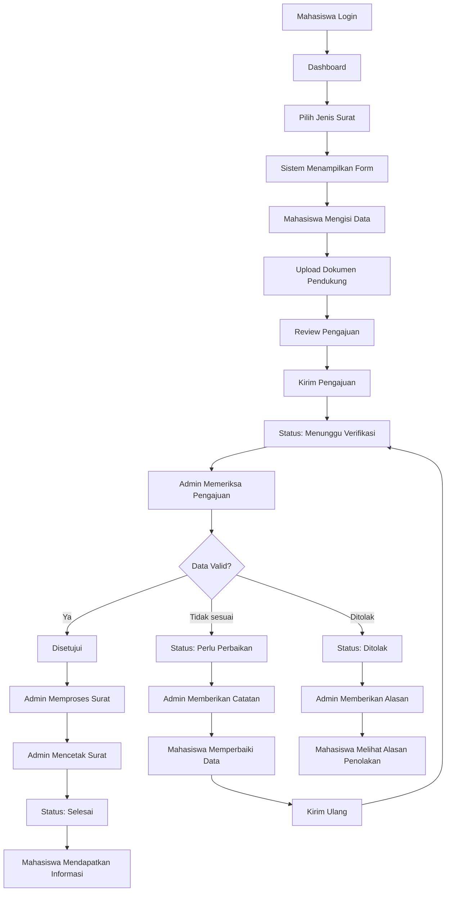
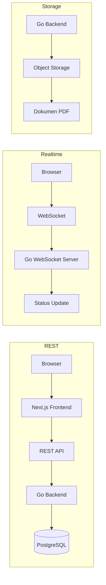

# Product Requirement Document (PRD)

| Item | Keterangan |
|---|---|
| **Nama Produk** | Sistem Informasi Persuratan Mahasiswa |
| **Versi** | 1.2 |
| **Status** | MVP — Backend (Go + Echo + GORM) dan Frontend (Next.js) terimplementasi, terhubung ke PostgreSQL |

---

## 1. Deskripsi Produk

Sistem Informasi Persuratan Mahasiswa adalah aplikasi berbasis web yang digunakan mahasiswa untuk mengajukan surat secara online tanpa perlu datang langsung ke bagian administrasi.

Mahasiswa memilih jenis surat, mengisi data yang diperlukan, mengirim pengajuan, lalu admin melakukan pemeriksaan dan persetujuan. Setelah disetujui, admin mencetak dan menindaklanjuti surat tersebut.

Mahasiswa dapat melihat status pengajuan surat secara realtime melalui dashboard.

Jenis surat yang tersedia pada versi awal:

1. Surat Keterangan Kuliah
2. Surat Keterangan Lulus
3. Surat Pengantar Izin Penelitian

## 2. Tujuan Produk

1. Mempermudah mahasiswa mengajukan surat secara online.
2. Mengurangi proses pengajuan surat secara manual.
3. Mempermudah admin memeriksa dan mengelola pengajuan.
4. Mempercepat proses penerbitan surat.
5. Memberikan informasi status surat secara realtime kepada mahasiswa.
6. Menyimpan riwayat pengajuan surat secara terstruktur.
7. Mengurangi risiko dokumen pengajuan hilang atau tidak terdokumentasi.
8. Menyediakan data pengajuan yang mudah dicari dan dikelola admin.

## 3. Target User

### A. Mahasiswa

1. Login ke sistem.
2. Melihat jenis surat.
3. Memilih jenis surat.
4. Mengisi data pengajuan.
5. Mengunggah dokumen pendukung jika diperlukan.
6. Mengirim pengajuan.
7. Melihat status pengajuan.
8. Melihat detail pengajuan.
9. Melihat riwayat surat.
10. Mendapatkan informasi ketika status surat berubah.

### B. Admin

1. Login ke dashboard admin.
2. Melihat seluruh pengajuan.
3. Memeriksa data mahasiswa.
4. Memeriksa dokumen pendukung.
5. Menyetujui pengajuan.
6. Menolak pengajuan.
7. Meminta mahasiswa melakukan perbaikan data.
8. Mengubah status surat.
9. Mencetak surat.
10. Mengunggah hasil surat jika diperlukan.
11. Melihat riwayat pengajuan.
12. Mencari dan memfilter surat.

## 4. Role dan Hak Akses

Role: **Mahasiswa**, **Admin**.

| Hak Akses | Mahasiswa | Admin |
|---|:---:|:---:|
| Login | ✓ | ✓ |
| Mengajukan surat | ✓ | |
| Melihat pengajuan sendiri | ✓ | |
| Melihat status pengajuan sendiri | ✓ | |
| Mengunggah dokumen | ✓ | |
| Memperbaiki pengajuan jika diminta | ✓ | |
| Melihat riwayat surat sendiri | ✓ | |
| Melihat profil sendiri | ✓ | |
| Melihat seluruh pengajuan | | ✓ |
| Melihat detail pengajuan | | ✓ |
| Memvalidasi data | | ✓ |
| Menyetujui pengajuan | | ✓ |
| Menolak pengajuan | | ✓ |
| Meminta revisi | | ✓ |
| Mengubah status | | ✓ |
| Mencetak surat | | ✓ |
| Mengunggah dokumen surat | | ✓ |
| Melihat seluruh riwayat | | ✓ |
| Mengelola data surat | | ✓ |

## 5. Alur Utama Sistem

### Alur pengajuan (jalur normal)



### Jika data tidak valid

Admin Memeriksa → Data Tidak Sesuai → Status: Perlu Perbaikan → Admin memberikan catatan → Mahasiswa memperbaiki data → Kirim Ulang → Status: Menunggu Verifikasi → Admin memeriksa kembali.

### Jika pengajuan ditolak

Admin Memeriksa → Pengajuan Ditolak → Admin memberikan alasan → Mahasiswa melihat alasan penolakan.

## 6. Status Pengajuan

| # | Status | Deskripsi |
|---|---|---|
| 1 | `DRAFT` | Mahasiswa sedang mengisi pengajuan dan belum mengirimkannya. |
| 2 | `MENUNGGU VERIFIKASI` | Pengajuan sudah dikirim dan sedang menunggu pemeriksaan admin. |
| 3 | `PERLU PERBAIKAN` | Admin menemukan data atau dokumen yang perlu diperbaiki. |
| 4 | `DISETUJUI` | Pengajuan telah lolos pemeriksaan admin. |
| 5 | `DIPROSES` | Nomor surat ditetapkan; surat dicetak lalu ditandatangani dan distempel pimpinan. |
| 6 | `SIAP DIAMBIL` | Surat fisik sudah lengkap (ttd & stempel); mahasiswa diberi tahu untuk mengambil. |
| 7 | `SELESAI` | Proses pengajuan surat telah selesai. |
| 8 | `DITOLAK` | Pengajuan ditolak oleh admin. |

Setiap perubahan status harus tercatat pada history.

Contoh:

| Waktu | Kejadian |
|---|---|
| 10:00 | Pengajuan dibuat |
| 10:02 | Menunggu verifikasi |
| 10:15 | Disetujui admin |
| 10:20 | Surat sedang diproses |
| 10:35 | Surat siap diambil |

## 7. Fitur Mahasiswa

### 7.1 Login

Mahasiswa login menggunakan **NIM** dan **Password**. Sistem melakukan autentikasi dan memberikan access token.

### 7.2 Dashboard Mahasiswa

Dashboard menampilkan:

- Total pengajuan
- Pengajuan sedang diproses
- Pengajuan selesai
- Pengajuan membutuhkan perbaikan
- Pengajuan ditolak
- Pengajuan terbaru

Contoh:

> **Pengajuan Aktif**
> Surat Keterangan Kuliah
> Status: Menunggu Verifikasi
> Diajukan: 06 Oktober 2026

### 7.3 Pilih Jenis Surat

Mahasiswa melihat daftar:

- Surat Keterangan Kuliah
- Surat Keterangan Lulus
- Surat Pengantar Izin Penelitian

Setiap jenis surat memiliki tombol **Ajukan Surat**.

Field form **hanya** berisi data yang dibutuhkan template surat resmi PPS (`backend/templates/sources/*.doc`). Data identitas (nama, NIM, program studi, program pendidikan, tempat/tanggal lahir) **tidak diisi ulang** oleh mahasiswa: ditampilkan read-only dari profil dan otomatis masuk ke placeholder surat.

### 7.4 Form Surat Keterangan Kuliah

Identitas dari profil: Nama, Tempat/Tgl. Lahir, No. Induk Mahasiswa, Program Pendidikan (Magister/Doktor, diturunkan dari nama prodi), Program Studi.

Field isian (key `application_data`):

| Key | Label | Validasi |
|---|---|---|
| `semester` | Semester | select `Ganjil` / `Genap` |
| `tahunAjaran` | Tahun Ajaran | `^\d{4}-\d{4}$`, contoh `2025-2026` |

### 7.5 Form Surat Keterangan Lulus

Identitas dari profil: sama dengan SKK.

| Key | Label | Validasi |
|---|---|---|
| `tanggalYudisium` | Tanggal Yudisium | date |
| `ipk` | IPK | `^[0-4][.,]\d{2}$`; dicetak beserta terbilang, mis. `3,85 (tiga koma delapan lima)` |
| `predikatKelulusan` | Predikat Kelulusan | select `Memuaskan` / `Sangat Memuaskan` / `Dengan Pujian (Cumlaude)` |
| `judulTesis` | Judul Tesis | teks |

### 7.6 Form Surat Pengantar Izin Penelitian

Identitas dari profil: Nama, NIM, Program Studi.

| Key | Label | Validasi |
|---|---|---|
| `judulTesis` | Judul Tesis | teks |
| `tujuanSurat` | Tujuan surat (Kepada Yth.) | teks, default `Ketua LP3M Universitas Muhammadiyah Makassar` |
| `kotaTujuan` | Kota tujuan (di -) | teks, default `Makassar` |
| `proposal` | Dokumen proposal penelitian | PDF/JPG/PNG ≤ 5 MB, **wajib** |
| `pendukung` | Dokumen pendukung lainnya | opsional |

Catatan: field lama (`keperluan`, `nomorTelepon`, `email`, `alamat`, `instansiTujuan`, `tanggalMulai/Selesai`, dll.) dihapus karena tidak ada di template resmi; labelnya tetap dikenali frontend untuk menampilkan pengajuan lama.

### 7.7 Review Pengajuan

Sebelum mengirim, mahasiswa melihat seluruh data yang telah diisi.

Tombol tersedia: **Kembali**, **Edit**, **Kirim Pengajuan**.

Sistem meminta konfirmasi sebelum pengajuan dikirim.

### 7.8 Tracking Status

Mahasiswa dapat melihat timeline:

| Tahap | Status |
|---|:---:|
| Pengajuan dibuat | ✓ |
| Menunggu verifikasi | ✓ |
| Disetujui | ✓ |
| Sedang diproses | ● |
| Siap diambil | ○ |
| Selesai | ○ |

Timeline berubah secara realtime.

### 7.9 Riwayat Pengajuan

- Nomor pengajuan
- Jenis surat
- Tanggal pengajuan
- Status
- Tanggal selesai

## 8. Fitur Admin

### 8.1 Dashboard Admin

Dashboard menampilkan:

- Total pengajuan
- Menunggu verifikasi
- Perlu perbaikan
- Disetujui
- Sedang diproses
- Selesai
- Ditolak

Admin juga melihat pengajuan terbaru.

**Implementasi dashboard (`/admin/dashboard`):**

| Blok | Isi | Sumber |
|---|---|---|
| KPI utama | Total pengajuan (+ hari ini / 7 hari), Butuh Tindakan (menunggu + disetujui + diproses), Rata-rata penyelesaian (hari), Tingkat penyelesaian (selesai vs ditolak) | `summary` + `stats` |
| Kartu status | 7 kartu berwarna per tahap dengan ikon & petunjuk; klik → daftar terfilter (Selesai → Arsip) | `summary` |
| Pengajuan Surat per Bulan | Grafik garis/area 12 bulan: dikirim vs selesai, tooltip per bulan | `stats.monthly` |
| Jenis Surat | Donat + bar proporsi per jenis | `stats.by_letter_type` |
| Antrean Verifikasi | 6 pengajuan `MENUNGGU_VERIFIKASI` terbaru + badge jumlah | `list` |
| Aktivitas Terbaru | 6 pengajuan terakhir diperbarui | `list` |

Grafik dirender SVG mandiri (`components/charts/charts.tsx`, tanpa pustaka charting); semua angka berasal dari API dan ter-invalidate oleh event WebSocket.

### 8.2 Daftar Pengajuan

**Kolom:** Nomor pengajuan, NIM, Nama mahasiswa, Jenis surat, Tanggal pengajuan, Status, Aksi.

**Filter:** Jenis surat, Status, Tanggal, NIM, Nama mahasiswa.

### 8.3 Detail Pengajuan

Admin dapat melihat: Data mahasiswa, Data surat, Dokumen pendukung, Tanggal pengajuan, Status, Riwayat status.

Tombol admin: **Setujui**, **Minta Perbaikan**, **Tolak**, **Proses**, **Cetak Surat**, **Selesai**.

### 8.4 Validasi Pengajuan

Admin memeriksa:

- Identitas mahasiswa
- Kelengkapan data
- Dokumen pendukung
- Kesesuaian data
- Keperluan surat

Jika terdapat kesalahan, admin memberikan catatan.

### 8.5 Arsip Surat

Menu **Arsip Surat** (`/admin/arsip`) menampilkan seluruh surat yang telah diterbitkan dan diserahkan. Pengajuan masuk ke arsip **otomatis** saat statusnya menjadi `SELESAI` (tidak ada tabel terpisah; arsip = `GET /api/admin/applications?status=SELESAI`).

**Kolom:** Nomor surat (+ nomor pengajuan), Jenis surat, Mahasiswa, Tanggal terbit (`processed_at`), Tanggal diserahkan (`completed_at`), Aksi.

**Aksi:** Lihat (pratinjau PDF via pdf.js), Unduh, Buka & Cetak, Detail Pengajuan.

**Filter:** pencarian (nomor surat, nomor pengajuan, NIM, nama), jenis surat; paginasi server-side.

Contoh:

> **Status:** Perlu Perbaikan
> **Catatan Admin:** "Proposal penelitian belum memiliki halaman pengesahan. Silakan upload dokumen yang sudah diperbaiki."

## 9. Fitur Pencetakan Surat

Setelah pengajuan disetujui, admin dapat mencetak surat. Sistem menghasilkan dokumen dari **template berplaceholder**, bukan dari kode yang di-hardcode, sehingga redaksi surat dapat diubah tanpa mengubah program.

### Template surat

Template mengikuti **surat resmi Program Pascasarjana** yang disimpan sebagai acuan di `backend/templates/sources/` (`template_surat-keterangan-kuliah.doc`, `template_surat-keterangan-lulus.doc`, `template_surat-pengantar-izin-penelitian.doc`). Tata letak kop (logo Unismuh, tiga baris nama lembaga, lambang Unggul, garis ganda, basmalah), tabel data, blok tanda tangan (tanggal Hijriah/Masehi, NBM), dan footer alamat direplikasi dari dokumen tersebut.

Berkas yang dipakai sistem adalah teks Go `text/template` di `backend/templates/letters/`:

| Berkas | Fungsi |
|---|---|
| `_kop.tmpl` | Teks kop surat (yayasan / universitas / unit) |
| `_ttd.tmpl` | Blok tanda tangan: tanggal Hijriah & Masehi (kecuali SIPI, yang tanggalnya di kepala surat), jabatan, nama, `NBM : …` |
| `_footer.tmpl` | Footer: Alamat / Telp. / Fax., Kota + kode pos |
| `SKK.tmpl` | Isi Surat Keterangan Kuliah |
| `SKL.tmpl` | Isi Surat Keterangan Lulus |
| `SIPI.tmpl` | Isi Surat Pengantar Izin Penelitian (format surat dinas: Nomor/Lamp./Hal, tujuan, salam) |

Gambar kop di `backend/templates/assets/` (`kop-logo-unismuh.png`, `kop-badge-unggul.png`, `kop-basmalah.png`), diekstrak dari dokumen resmi.

Nama berkas isi = `code` pada tabel `letter_types`. Menambah jenis surat baru = tambah baris `letter_types` + satu berkas `<CODE>.tmpl`.

Template dan aset di-embed ke binary (`templates/embed.go`). Set `LETTER_TEMPLATE_DIR=/path` (berisi `letters/` dan `assets/`) untuk memakai direktori eksternal sehingga template bisa diubah di production tanpa rebuild; perubahan terbaca pada render berikutnya.

### Markup template

| Sintaks | Hasil |
|---|---|
| `@judul: …` | Judul surat (tengah, tebal, garis bawah) — SKK/SKL |
| `@nomor: …` | Baris nomor (di bawah judul, atau di kepala surat dinas) |
| `@lamp: …` / `@hal: …` | Baris “Lamp.” dan “H a l” pada surat dinas (SIPI) |
| `@tanggal-h: …` / `@tanggal-m: …` | Tanggal Hijriah (bergaris bawah) dan Masehi di kanan kepala surat dinas |
| `@tujuan: …` / `@di: …` | “Kepada Yth,” + tujuan (tebal) dan “di -” + kota |
| `@salam-buka: …` / `@salam-tutup: …` | Salam pembuka/penutup (miring) |
| `\| Label \| Nilai` | Satu baris tabel dua kolom (data mahasiswa) |
| teks biasa | Paragraf rata kiri-kanan; paragraf dipisah baris kosong |
| `# teks` / `## teks` | Pada `_kop`/`_ttd`: baris besar/sedang tebal |
| `_ teks` | Baris bergaris bawah (dipakai tanggal Hijriah pada `_ttd`) |

### Placeholder yang tersedia

Didefinisikan oleh `pdf.LetterData` (`internal/pdf/letter_data.go`) dan diisi oleh `service.buildLetterData`:

| Placeholder | Sumber | Contoh |
|---|---|---|
| `{{ .JenisSurat }}` | `letter_types.name` | Surat Keterangan Kuliah |
| `{{ .KodeSurat }}` | `letter_types.code` | SKK |
| `{{ .NomorSurat }}` | input admin saat Proses Surat | 1253/A.2-II/X/1448/2026 |
| `{{ .NomorAjuan }}` | `applications.application_number` | SKK-20261006-0001 |
| `{{ .TanggalSurat }}` | tanggal render, Masehi | 06 Oktober 2026 |
| `{{ .TanggalHijriah }}` | tanggal render, konversi Hijriah tabular (`internal/pdf/calendar.go`) | 23 Rabiul Akhir 1448 |
| `{{ .Nama }}` `{{ .NIM }}` `{{ .ProgramStudi }}` `{{ .Fakultas }}` | `student_profiles` | |
| `{{ .ProgramPendidikan }}` | diturunkan dari nama prodi | Magister (S2) |
| `{{ .TempatLahir }}` `{{ .TanggalLahir }}` `{{ .TempatTanggalLahir }}` | `student_profiles` | Makassar, 12 April 1998 |
| `{{ .Alamat }}` `{{ .NomorTelepon }}` `{{ .Email }}` | profil | |
| `{{ .Data.<field> }}` | `application_data` (lihat §7.4–7.6) | `{{ .Data.semester }}`, `{{ .Data.judulTesis }}` |
| `{{ .Instansi.Yayasan \| .Universitas \| .Unit \| .Alamat \| .Telepon \| .Fax \| .Website \| .Kota \| .KodePos }}` | env `LETTER_*` | |
| `{{ .Penandatangan.Jabatan \| .Nama \| .NomorInduk }}` | env `LETTER_SIGNER_*` | Direktur, / Prof. … / 613 949 |

Fungsi bantu: `upper`, `lower`, `title`, `trim`, `trimSuffix ","`, `tanggal` (ISO → “15 September 2026”), `hijriah` (ISO → tanggal Hijriah), `terbilang` (`"3,85"` → “tiga koma delapan lima”), `default "-"`. Kondisi `{{ if … }}` dan logika template Go lainnya tersedia.

### Alur render

```
Admin preview / process / print
  → service.buildLetterData(app, nomorSurat, cfg.Letter)   # model → placeholder
  → pdf.TemplateGenerator.Generate(data)
       → TemplateLoader.Render("_kop" | <CODE> | "_ttd" | "_footer")  # text/template
       → template_parser: meta / paragraf / tabel / garis bawah
       → fpdf_renderer: A4, Helvetica, kop berlogo + garis ganda + basmalah,
         kepala surat dinas (SIPI), tabel, blok ttd, footer alamat
  → PDF disimpan ke storage (process) atau di-stream (print/preview)
```

Admin dapat: **Setujui** (`approve` — validasi data, tanpa nomor), **Preview surat** (`print` saat Disetujui; memakai nomor usulan sistem), **Proses Surat** (`process` — tetapkan nomor surat (diusulkan otomatis, dapat diubah), PDF dibuat & disimpan, status → Sedang Diproses), **Print / Download PDF** untuk dibawa ke pimpinan (tanda tangan & stempel), lalu **Surat Siap Diambil** (`ready` — kirim notifikasi, status → Siap Diambil). PDF yang dihasilkan sistem adalah naskah cetak; keabsahan surat tetap dari tanda tangan basah dan stempel pada surat fisik.

### Struktur nomor surat

Pola penomoran **dideklarasikan di setiap template** lewat baris `@format-nomor:` sehingga mengikuti template (bukan kode program) dan ikut berubah bila template diganti via `LETTER_TEMPLATE_DIR`:

| Template | `@format-nomor` | Contoh |
|---|---|---|
| `SKK.tmpl`, `SKL.tmpl` | `{urut}/A.4-I/{bulan}/{tahun-h}/{tahun-m}` | `0631/A.4-I/IV/1445/2024` |
| `SIPI.tmpl` | `{urut}/A.2-II/{bulan}/{tahun-h}/{tahun-m}` | `1253/A.2-II/VII/1446/2024` |

Token: `{urut}` nomor urut 4 digit · `{bulan}` bulan Masehi Romawi · `{tahun-h}` tahun Hijriah · `{tahun-m}` tahun Masehi. Nomor urut berjalan **per kode unit** (segmen kedua — SKK dan SKL berbagi deret `A.4-I`, SIPI deret `A.2-II`) dan **mulai dari 0001 setiap tahun Masehi** (= urutan tertinggi kode itu pada tahun berjalan + 1). **Nomor surat unik**: dijaga oleh unique index parsial `uq_applications_letter_number` dan, saat Proses Surat, advisory lock per kode unit + pengecekan ulang di dalam transaksi; nomor yang bentrok ditolak `409` dengan pesan berisi nomor berikutnya yang tersedia, dan frontend memperbarui usulannya otomatis. Usulan dihitung backend (`internal/pdf/letter_number.go` + `AdminService.suggestLetterNumber`), dikirim sebagai `letter_number_suggestion`, dan dapat diubah admin saat **Proses Surat**. Nomor surat tampil di kolom **No. Surat** daftar pengajuan dan pada baris pengajuan di dashboard/riwayat.

Tata letak kop: teks lembaga **di tengah** antara logo Unismuh (kiri) dan lambang Unggul (kanan); footer alamat/telepon/fax **satu baris** di bawah garis.

Unit test `internal/pdf/generator_test.go` memastikan setiap template ter-render dan menghasilkan PDF valid.

## 10. Notifikasi Realtime

Sistem memberikan notifikasi ketika status berubah.

Contoh ketika admin menyetujui pengajuan:

> "Pengajuan Surat Keterangan Kuliah Anda telah disetujui."

Ketika membutuhkan perbaikan:

> "Pengajuan Surat Pengantar Izin Penelitian membutuhkan perbaikan. Silakan periksa catatan admin."

**Teknologi realtime:** WebSocket.
**Alternatif:** Server-Sent Events.
**Rekomendasi:** WebSocket menggunakan Go WebSocket.

## 11. Arsitektur Sistem

```
Frontend (Next.js, React, TypeScript, Tailwind CSS, shadcn/ui)
        ↓
API Gateway / Reverse Proxy
        ↓
Backend (Golang, Echo Framework, REST API, WebSocket)
        ↓
Database (PostgreSQL)
        ↓
Storage (Object Storage: MinIO / AWS S3 / Cloudflare R2)
```



## 12. Tech Stack

**Frontend (terimplementasi):** Next.js 16 (App Router), React 19, TypeScript, Tailwind CSS v4 (token dari DESIGN.md via `@theme`), React Hook Form + Zod, TanStack Query v5, Axios, Zustand (persist), WebSocket native, lucide-react, sonner, date-fns. Komponen UI ditulis sendiri mengikuti DESIGN.md (pill CTA, utility card 18px, frosted sub-nav) — tidak memakai shadcn/ui agar tidak perlu meng-override gaya bawaannya.

**Backend (terimplementasi):** Go 1.25, Echo v4, GORM + `gorm.io/driver/postgres`, gormigrate v2 (migrasi berversi), `golang-jwt/jwt` v5, bcrypt (`x/crypto`), `gorilla/websocket`, `go-playground/validator` v10, `go-pdf/fpdf`, `minio-go` v7, `godotenv`.

**Database:** PostgreSQL.

**Storage:** MinIO atau S3-compatible object storage.

**Reverse Proxy:** Nginx atau Traefik.

**Deployment:** Docker, Docker Compose, GitHub Actions.

**Production:** Linux Server, Docker, Nginx, PostgreSQL, MinIO.

**Monitoring:** Prometheus, Grafana.

**Logging:** Loki, Promtail.

## 13. Struktur Backend

Monolith modular, lapisan **Handler → Service → Repository → GORM → PostgreSQL**. Kontrak API (request/response) hidup di package **dto**; model GORM tidak pernah dikirim langsung ke klien.

```
backend/
├── cmd/
│   ├── server/main.go              # entry point HTTP + WebSocket (opsional AUTO_MIGRATE)
│   └── migrate/main.go             # CLI migrasi: up | to <id> | rollback | status | seed | fresh
├── internal/
│   ├── config/config.go            # pemuatan .env → struct Config (+ LetterConfig)
│   ├── database/database.go        # koneksi GORM (pool, logger)
│   ├── model/models.go             # entitas GORM = sumber kebenaran skema
│   ├── dto/                        # kontrak request & response, satu file per domain
│   │   ├── common_dto.go           #   Pagination, Paginated[T]
│   │   ├── auth_dto.go             #   LoginRequest, LoginResponse, MeResponse
│   │   ├── student_dto.go          #   UpdateProfileRequest, StudentProfileResponse
│   │   ├── letter_type_dto.go      #   LetterTypeResponse
│   │   ├── application_dto.go      #   Create/Update/UploadDocumentRequest, ApplicationResponse, …
│   │   ├── admin_dto.go            #   AdminListQuery, NoteRequest, GeneratePDFRequest, PrintQuery
│   │   └── notification_dto.go     #   NotificationResponse
│   ├── repository/                 # satu file per entitas, akses data via GORM
│   │   ├── errors.go               #   ErrNotFound + pemetaan error GORM
│   │   ├── user_repository.go
│   │   ├── student_profile_repository.go
│   │   ├── letter_type_repository.go
│   │   ├── application_repository.go
│   │   ├── document_repository.go
│   │   ├── status_history_repository.go
│   │   ├── notification_repository.go
│   │   └── audit_log_repository.go
│   ├── service/                    # satu file per domain, aturan bisnis
│   │   ├── errors.go               #   Error ber-kode HTTP
│   │   ├── actor.go                #   identitas pemanggil dari JWT
│   │   ├── auth_service.go
│   │   ├── student_service.go
│   │   ├── letter_type_service.go
│   │   ├── application_service.go  #   alur mahasiswa (draft → upload → submit)
│   │   ├── admin_service.go        #   state machine status, generate & cetak PDF
│   │   ├── letter_data_builder.go  #   model + config → pdf.LetterData (placeholder)
│   │   └── notification_service.go
│   ├── handler/                    # satu file per domain, HTTP ↔ service
│   │   ├── common.go               #   fail, bindValidate, paramUUID
│   │   ├── auth_handler.go
│   │   ├── student_handler.go
│   │   ├── letter_type_handler.go
│   │   ├── application_handler.go
│   │   ├── admin_handler.go
│   │   ├── notification_handler.go
│   │   └── websocket_handler.go
│   ├── middleware/
│   │   ├── jwt_middleware.go       # verifikasi token → Actor di context
│   │   └── role_middleware.go      # RequireRole
│   ├── validator/validator.go      # go-playground/validator + pesan Indonesia
│   ├── websocket/hub.go            # hub koneksi per user/role
│   ├── storage/
│   │   ├── storage.go              # interface Storage
│   │   ├── local_storage.go
│   │   └── minio_storage.go
│   ├── pdf/                        # template surat → PDF
│   │   ├── generator.go            #   interface Generator + TemplateGenerator
│   │   ├── letter_data.go          #   LetterData = kontrak placeholder
│   │   ├── calendar.go             #   konversi Hijriah, terbilang, program pendidikan
│   │   ├── template_loader.go      #   embedded / LETTER_TEMPLATE_DIR, template funcs, aset
│   │   ├── template_parser.go      #   @meta, | tabel |, paragraf, _ garis bawah → blok
│   │   ├── fpdf_renderer.go        #   blok → PDF A4 (go-pdf/fpdf), kop berlogo, footer
│   │   └── generator_test.go
│   └── server/
│       ├── server.go               # Echo + middleware global
│       └── router.go               # wiring dependensi + seluruh route
├── templates/
│   ├── embed.go                    # go:embed letters/*.tmpl assets/*.png
│   ├── letters/
│   │   ├── _kop.tmpl  _ttd.tmpl  _footer.tmpl
│   │   └── SKK.tmpl   SKL.tmpl   SIPI.tmpl
│   ├── assets/                     # kop-logo-unismuh / kop-badge-unggul / kop-basmalah .png
│   └── sources/                    # template .doc resmi PPS (acuan, tidak dibaca program)
├── migrations/
│   ├── migrations.go               # daftar migrasi berversi (gormigrate)
│   └── seed.go                     # SeedAdmin, SeedDemo (idempoten)
├── pkg/
│   ├── response/response.go        # envelope JSON seragam
│   └── jwt/jwt.go                  # sign/parse token
├── scripts/smoke.sh                # uji alur end-to-end via curl
├── docker-compose.yml              # postgres + minio + job migrate + backend
├── Dockerfile
├── Makefile
└── .env.example
```

### Konvensi penamaan file

- `*_dto.go` — satu domain per file; `XxxRequest` (tag `json`/`query`/`form` + `validate`), `XxxResponse`, dan mapper `XxxFromModel(model) XxxResponse`. Hanya dto yang tahu bentuk JSON.
- `*_repository.go` — satu entitas per file; tipe `XxxRepository`, konstruktor `NewXxxRepository(db)`.
- `*_service.go` — satu domain per file; tipe `XxxService`, konstruktor `NewXxxService(...)`. Dependensi > 3 dikemas dalam struct `XxxServiceDeps`. Service menerima `dto.XxxRequest` dan mengembalikan `dto.XxxResponse`.
- `*_handler.go` — satu domain per file; tipe `XxxHandler`, konstruktor `NewXxxHandler(svc)`; setiap method diberi komentar endpoint-nya. Handler hanya bind → validate → panggil service → tulis respons.
- `*_middleware.go`, `*_storage.go`, `*_builder.go`, `*_loader.go`, `*_parser.go`, `*_renderer.go` — mengikuti pola yang sama.
- Helper lintas-file dalam satu package diletakkan di `errors.go` / `common.go` / `common_dto.go`, bukan di file domain.

### Alur data satu request

```
HTTP JSON → handler.bindValidate(dto.XxxRequest)
          → service.Xxx(ctx, actor, req) → repository (GORM) → model
          → dto.XxxFromModel(model) → dto.XxxResponse
          → response.OK / Created / Paginated → HTTP JSON
```

### Konvensi ORM & Migrasi

- **ORM:** GORM (`gorm.io/gorm`) dengan driver `gorm.io/driver/postgres`.
- **Migrasi:** `github.com/go-gormigrate/gormigrate/v2` di atas GORM. Setiap migrasi punya ID `YYYYMMDDHHMM_deskripsi`, fungsi `Migrate` dan `Rollback`, berjalan dalam transaksi. Riwayat disimpan pada tabel `schema_migrations`.
- Perubahan skema **selalu** lewat migrasi baru di `migrations/List()`; `AutoMigrate` dipanggil dari dalam migrasi (bukan langsung di server) sehingga skema dev dan production identik dan dapat di-rollback.
- Seed data referensi (jenis surat) adalah migrasi tersendiri; seed akun admin/demo dipanggil terpisah dan idempoten.
- `AUTO_MIGRATE=true` hanya untuk development. Di production migrasi dijalankan sebagai job (`migrate up`) sebelum container backend start (lihat `docker-compose.yml`).

| Perintah | Fungsi |
|---|---|
| `make db-up` | Jalankan PostgreSQL + MinIO |
| `make migrate-up` | Terapkan migrasi yang belum berjalan |
| `make migrate-down` | Rollback migrasi terakhir |
| `make migrate-status` | Tampilkan status tiap migrasi |
| `make migrate-seed` | Seed admin (+ demo mahasiswa di non-production) |
| `make migrate-fresh` | Drop semua tabel → migrasi ulang → seed (non-production) |
| `make run` | Jalankan server |
| `make test` | Unit test (termasuk render seluruh template surat) |

### Konfigurasi template surat (`.env`)

| Variabel | Placeholder | Default |
|---|---|---|
| `LETTER_TEMPLATE_DIR` | — | kosong (pakai template & aset embedded) |
| `LETTER_YAYASAN`, `LETTER_UNIVERSITAS`, `LETTER_UNIT`, `LETTER_ALAMAT`, `LETTER_TELEPON`, `LETTER_FAX`, `LETTER_WEBSITE`, `LETTER_KOTA`, `LETTER_KODE_POS` | `{{ .Instansi.* }}` | data kop/footer surat resmi PPS |
| `LETTER_SIGNER_TITLE`, `LETTER_SIGNER_NAME`, `LETTER_SIGNER_ID` | `{{ .Penandatangan.* }}` | Direktur, / Prof. Dr. H. Irwan Akib, M.Pd. / 613 949 |

## 14. Struktur Frontend

Next.js App Router. Seluruh data berasal dari backend (tidak ada mock). Tipe di `types/api.ts` adalah cermin 1:1 dari `backend/internal/dto` (snake_case).

```
frontend/
├── public/brand/logo-pps.png        # logo resmi Pascasarjana Unismuh
├── .env.local                       # NEXT_PUBLIC_API_URL, NEXT_PUBLIC_WS_URL
└── src/
    ├── app/
    │   ├── layout.tsx                   # font Inter (pengganti SF Pro), metadata
    │   ├── providers.tsx                # QueryClient + Toaster
    │   ├── globals.css                  # token DESIGN.md → Tailwind @theme
    │   ├── page.tsx                     # redirect sesuai role
    │   ├── login/page.tsx
    │   ├── (student)/                   # layout: AppShell role=mahasiswa
    │   │   ├── dashboard/
    │   │   ├── surat/                   # pilih jenis (GET /letter-types)
    │   │   │   ├── keterangan-kuliah/   # SKK
    │   │   │   ├── keterangan-lulus/    # SKL
    │   │   │   └── izin-penelitian/     # SIPI
    │   │   ├── pengajuan/[id]/          # detail + timeline + mode perbaikan
    │   │   ├── riwayat/
    │   │   └── profile/                 # lihat + ubah kontak (PUT /student/profile)
    │   └── admin/                       # layout: AppShell role=admin
    │       ├── dashboard/
    │       ├── pengajuan/               # tabel + filter + paginasi server-side
    │       ├── pengajuan/[id]/          # detail + panel aksi + preview PDF
    │       └── arsip/                   # arsip surat SELESAI: cari nomor surat, lihat/unduh PDF
    ├── components/
    │   ├── brand/logo.tsx
    │   ├── ui/                          # button, field, card, badge, dialog
    │   ├── layout/                      # app-shell (guard + realtime), top-nav, page-header
    │   ├── forms/                       # letter-form (wizard), file-input, letter-form-page
    │   ├── surat/                       # application-row, application-detail, admin-action-panel, pdf-viewer (pdf.js)
    │   ├── status/status-timeline.tsx
    │   └── notification/notification-bell.tsx
    ├── lib/
    │   ├── api/client.ts                # axios + Bearer, ApiError, tokenizedUrl (iframe/download)
    │   ├── api/index.ts                 # authApi, studentApi, letterTypeApi, applicationApi, adminApi, notificationApi
    │   ├── websocket/client.ts          # WS ke /ws?token=, reconnect, refcount
    │   ├── letter-forms.ts              # definisi field + skema Zod per jenis surat
    │   ├── status.ts                    # label/tone status, timeline, label field
    │   └── utils.ts
    ├── hooks/
    │   ├── queries.ts                   # TanStack Query hooks + query keys
    │   └── use-realtime.ts              # WS → invalidate cache + toast
    ├── stores/auth.ts                   # Zustand persist (user); token di localStorage
    └── types/api.ts                     # = backend dto
```

### Alur data frontend

- Autentikasi: `POST /api/auth/login` → token disimpan; axios interceptor menambahkan `Authorization: Bearer`. 401 → sesi dibersihkan, redirect `/login?expired=1`.
- Pengajuan baru: `POST /applications` (draft) → `POST /:id/documents` per berkas → `POST /:id/submit`. Perbaikan: `PUT /:id` → upload opsional → submit.
- Realtime: satu koneksi WS per tab selama login; setiap event meng-invalidate cache `applications`, `admin`, `notifications` dan menampilkan toast.
- PDF: pratinjau/unduh memakai `tokenizedUrl()` (token di query) karena `<iframe>`/`<a>` tidak dapat mengirim header.
- Penjaga rute: `AppShell` memeriksa role dari store; salah role → redirect ke dashboard yang sesuai.

### Penerapan DESIGN.md

- Kanvas `#f5f5f7`, kartu putih radius 18px hairline tanpa shadow; satu aksen aksi `#0066cc`.
- Body 17px/-0.374px, display 600 dengan tracking negatif; Inter sebagai pengganti SF Pro.
- CTA pill, utility button 8px, chip filter pill; `scale(0.95)` saat ditekan; fokus ring `#0071e3`.
- Nav dua baris: global-nav hitam 44px + sub-nav frosted (backdrop-blur) berisi logo.
- Satu-satunya shadow (`3px 5px 30px rgba(0,0,0,.22)`) dipakai pada “kertas” pratinjau PDF di atas tile gelap.

## 15. Database

Skema dibentuk dari struct GORM di `internal/model/models.go`. Primary key memakai `uuid` (`gen_random_uuid()`), timestamp `timestamptz`. Relasi anak ke `applications` memakai `ON DELETE CASCADE`.

### Tabel `users` ← `model.User`

`id`, `nim` (unique), `name`, `email` (unique), `password` (bcrypt), `role` (`mahasiswa`/`admin`), `created_at`, `updated_at`

### Tabel `student_profiles` ← `model.StudentProfile`

`id`, `user_id` (unique, FK users), `nim`, `nama`, `program_studi`, `fakultas`, `tempat_lahir`, `tanggal_lahir` (date), `alamat`, `nomor_telepon`, `email`, `created_at`, `updated_at`

### Tabel `letter_types` ← `model.LetterType`

`id`, `code` (unique), `name`, `description`, `is_active`, `requires_document`, `created_at`, `updated_at`

Data awal (migrasi `202610060002_seed_letter_types`):

| code | name | requires_document |
|---|---|:---:|
| SKK | Surat Keterangan Kuliah | – |
| SKL | Surat Keterangan Lulus | – |
| SIPI | Surat Pengantar Izin Penelitian | ✓ |

### Tabel `applications` ← `model.Application`

`id`, `application_number` (unique), `user_id` (FK), `letter_type_id` (FK), `status`, `admin_note`, `letter_number`, `letter_file_path`, `submitted_at`, `processed_at`, `completed_at`, `created_at`, `updated_at`

Indeks tambahan (migrasi `202610060003`): `(status, updated_at DESC)` untuk daftar admin, `(user_id, created_at DESC)` untuk daftar mahasiswa.

### Tabel `application_data` ← `model.ApplicationData`

`id`, `application_id` (FK cascade), `field_name`, `field_value` — unique `(application_id, field_name)`. Pola EAV untuk field dinamis per jenis surat.

### Tabel `documents` ← `model.Document`

`id`, `application_id` (FK cascade), `document_type`, `file_name`, `file_path` (key di storage), `mime_type`, `file_size`, `uploaded_at`

### Tabel `status_histories` ← `model.StatusHistory`

`id`, `application_id` (FK cascade), `status`, `note`, `changed_by` (uuid), `changed_by_name`, `created_at`

### Tabel `notifications` ← `model.Notification`

`id`, `user_id`, `application_id`, `title`, `message`, `is_read`, `created_at` — indeks `(user_id, is_read, created_at DESC)`

### Tabel `audit_logs` ← `model.AuditLog`

`id`, `actor_id`, `action`, `target_id`, `detail`, `ip`, `created_at` — mencatat setiap aksi admin (PRD §19 butir 13).

### Tabel `schema_migrations`

Dikelola gormigrate; satu baris per ID migrasi yang sudah diterapkan.

### Daftar migrasi saat ini

| ID | Isi | Rollback |
|---|---|---|
| `202610060001_init_schema` | `CREATE EXTENSION pgcrypto`; AutoMigrate seluruh model | Drop seluruh tabel (urutan terbalik) |
| `202610060002_seed_letter_types` | Insert SKK, SKL, SIPI (FirstOrCreate) | Hapus tiga kode tersebut |
| `202610060003_add_application_indexes` | Indeks komposit applications & notifications | Drop indeks |
| `202610060004_unique_letter_number` | Unique index parsial `applications(letter_number) WHERE letter_number <> ''` | Drop indeks |

## 16. API Endpoint

### Authentication

| Method | Endpoint |
|---|---|
| POST | `/api/auth/login` |
| POST | `/api/auth/logout` |
| GET | `/api/auth/me` |

### Student

| Method | Endpoint |
|---|---|
| GET | `/api/student/profile` |
| PUT | `/api/student/profile` |

### Letter

| Method | Endpoint |
|---|---|
| GET | `/api/letter-types` |
| GET | `/api/letter-types/:id` |

### Applications (role: mahasiswa)

| Method | Endpoint | Keterangan |
|---|---|---|
| POST | `/api/applications` | Buat draft `{letter_code, data}` → status `DRAFT`, nomor pengajuan dibuat |
| GET | `/api/applications` | Daftar milik sendiri |
| GET | `/api/applications/summary` | Hitung per status untuk dashboard |
| GET | `/api/applications/:id` | Detail (hanya milik sendiri) |
| PUT | `/api/applications/:id` | Ubah `data` (hanya saat `DRAFT`/`PERLU_PERBAIKAN`) |
| POST | `/api/applications/:id/documents` | Multipart `document_type`, `file` (PDF, ≤ `MAX_UPLOAD_MB`); satu berkas per tipe |
| POST | `/api/applications/:id/submit` | Validasi kelengkapan field & dokumen wajib → `MENUNGGU_VERIFIKASI`. **Verifikasi duplikat**: ditolak `409` bila mahasiswa sudah punya pengajuan sejenis (bukan Draft/Ditolak) dengan identitas sama — SKK: `semester`+`tahunAjaran`, SKL: `tanggalYudisium`, SIPI: `judulTesis` (perbandingan abaikan huruf besar/kecil & spasi tepi); pesan menyebut nomor & status pengajuan yang sudah ada |
| GET | `/api/applications/:id/history` | Riwayat status |
| GET | `/api/documents/:id` | Stream berkas (pemilik atau admin) |

### Admin (role: admin)

| Method | Endpoint | Transisi |
|---|---|---|
| GET | `/api/admin/applications` | Filter `q`, `status`, `letter_code`, `date_from`, `date_to`, `page`, `per_page` |
| GET | `/api/admin/applications/summary` | Hitung per status |
| GET | `/api/admin/applications/stats` | Data dashboard: `monthly[]` (12 bulan, submitted/completed), `by_letter_type[]`, `today`, `this_week`, `avg_process_days`, `completion_rate` |
| GET | `/api/admin/applications/:id` | Detail; menyertakan `letter_number_suggestion` (usulan nomor surat) selama nomor belum ditetapkan |
| POST | `/api/admin/applications/:id/approve` | `MENUNGGU_VERIFIKASI → DISETUJUI` |
| POST | `/api/admin/applications/:id/revision` | `MENUNGGU_VERIFIKASI → PERLU_PERBAIKAN` (`{note}` ≥ 10 karakter) |
| POST | `/api/admin/applications/:id/reject` | `MENUNGGU_VERIFIKASI → DITOLAK` (`{note}`) |
| POST | `/api/admin/applications/:id/process` | `DISETUJUI → DIPROSES`; `{letter_number}` wajib (usulan tersedia di `letter_number_suggestion`); PDF dibuat dari template & disimpan untuk dicetak, ditandatangani, dan distempel pimpinan |
| POST | `/api/admin/applications/:id/ready` | `DIPROSES → SIAP_DIAMBIL`; mengirim notifikasi ke mahasiswa bahwa surat fisik siap diambil |
| POST | `/api/admin/applications/:id/complete` | `SIAP_DIAMBIL → SELESAI` |
| GET | `/api/admin/applications/:id/print` | PDF tersimpan, atau render pratinjau dari template (`?letter_number=`, `?download=true`) |

Transisi di luar tabel ditolak dengan **409 Conflict**. Setiap transisi: tulis `status_histories`, buat `notifications`, tulis `audit_logs`, dan kirim event WebSocket — semua dalam satu transaksi database.

### Notification

| Method | Endpoint |
|---|---|
| GET | `/api/notifications` |
| PUT | `/api/notifications/:id/read` |
| PUT | `/api/notifications/read-all` |

### Lainnya

| Method | Endpoint |
|---|---|
| GET | `/health` | Ping DB + jumlah klien WS |

### Format respons

```json
{ "success": true, "message": "...", "data": {}, "meta": { "page": 1, "per_page": 20, "total": 0, "total_pages": 0 } }
```

Error validasi mengembalikan **422** dengan `errors: { field: pesan }`.

### WebSocket

Endpoint: `/ws?token=<jwt>` (token juga diterima lewat header `Authorization`). Event dikirim ke user pemilik pengajuan; event `application.created` dikirim ke seluruh admin.

Contoh event:

- `application.status.updated`
- `application.created`
- `application.revision.required`
- `application.approved`
- `application.completed`

## 17. Contoh WebSocket Event

Ketika admin menyetujui surat:

```json
{
  "event": "application.approved",
  "data": {
    "application_id": "4ed6ca6d-317f-4a61-9a34-0bddf0e8b9b5",
    "application_number": "SKK-20261006-0002",
    "status": "DISETUJUI",
    "message": "Pengajuan Surat Keterangan Kuliah Anda telah disetujui."
  }
}
```

Frontend menerima event tersebut dan memperbarui status tanpa refresh halaman.

## 18. Nomor Pengajuan

Format: `[JENIS]-[TAHUN][BULAN][TANGGAL]-[SEQUENCE]`

Contoh:

- `SKK-20261006-0001`
- `SKL-20261006-0002`
- `SIPI-20261006-0003`

`SEQUENCE` adalah urutan harian lintas jenis surat, dihitung dalam transaksi dengan `pg_advisory_xact_lock` agar unik saat pengajuan bersamaan.

## 19. Keamanan

1. JWT authentication.
2. Password hashing menggunakan bcrypt.
3. Role-based access control.
4. Validasi input.
5. Validasi tipe file.
6. Batas ukuran upload.
7. HTTPS pada production.
8. CORS configuration.
9. Rate limiting.
10. SQL injection prevention melalui ORM.
11. XSS protection.
12. Authorization pada setiap endpoint.
13. Audit log untuk aktivitas admin.
14. Validasi akses dokumen.

Mahasiswa hanya boleh melihat pengajuan miliknya sendiri. Admin memiliki akses terhadap pengajuan mahasiswa sesuai hak aksesnya.

## 20. Non-Functional Requirements

**Performance**

- API response target < 500 ms untuk request normal.
- Dashboard tidak melakukan reload penuh saat status berubah.
- Upload dokumen menggunakan multipart upload.
- Pagination digunakan pada daftar pengajuan.

**Availability:** Sistem harus berjalan 24/7 pada server production.

**Security:** Semua komunikasi production menggunakan HTTPS.

**Scalability:** Backend Go dirancang stateless sehingga jumlah instance backend dapat ditambah jika jumlah pengguna meningkat.

**Maintainability:** Backend menggunakan pendekatan berlapis:

```
Handler → Service → Repository → Database
```

## 21. UI/UX

Gaya visual: Modern, Minimalis, Profesional, Responsive, Mobile friendly.

### Halaman utama mahasiswa (Dashboard)

Card:

| Total Pengajuan | Menunggu Verifikasi | Diproses | Selesai |
|:---:|:---:|:---:|:---:|
| 3 | 1 | 1 | 1 |

Bagian **Pengajuan Terbaru**:

> Surat Keterangan Kuliah
> SKK-20261006-0001
> Status: Menunggu Verifikasi
> [Lihat Detail]

## 22. Timeline Status

Contoh UI:

| Tahap | Waktu | Status |
|---|---|:---:|
| Pengajuan Dibuat | 06 Oktober 2026, 09:10 | ✓ |
| Menunggu Verifikasi | 06 Oktober 2026, 09:11 | ✓ |
| Disetujui | 06 Oktober 2026, 09:25 | ✓ |
| Sedang Diproses | 06 Oktober 2026, 09:30 | ● |
| Siap Diambil | - | ○ |
| Selesai | - | ○ |

## 23. MVP

**Mahasiswa:** Login, Dashboard, Profil, Pilih surat, Form surat, Upload dokumen, Submit pengajuan, Tracking status, Riwayat.

**Admin:** Login, Dashboard, Daftar pengajuan, Detail pengajuan, Validasi, Approve, Reject, Request revision, Generate PDF, Print, Update status.

**Realtime:** WebSocket, Status update, Notification.

**Surat:**

1. Surat Keterangan Kuliah
2. Surat Keterangan Lulus
3. Surat Pengantar Izin Penelitian

## 24. Future Development

1. Tanda tangan digital (digital signature).
2. QR Code pada surat dan verifikasi surat via QR Code.
3. Integrasi SIAKAD / data mahasiswa.
4. Email notification.
5. WhatsApp notification.
6. Multi-level approval.
7. Editor template surat via UI admin (template berplaceholder sudah tersedia; saat ini diubah lewat berkas `.tmpl` / `LETTER_TEMPLATE_DIR`).
8. Nomor surat otomatis.
9. Arsip digital.
10. Dashboard statistik.
11. Export Excel.
12. UI audit trail (tabel `audit_logs` sudah tersedia).
13. Role superadmin, pimpinan, operator fakultas.
14. Refresh token / token revocation (saat ini JWT stateless).

## 25. Flow Sistem Lengkap

**Mahasiswa**

Login → Dashboard → Pilih Surat → Isi Form → Upload Dokumen → Review → Submit → Menunggu Verifikasi

**Admin**

Dashboard → Pengajuan Baru → Periksa Data → Periksa Dokumen → Valid?

- **Tidak** → Perlu Perbaikan → Mahasiswa Memperbaiki → Submit Ulang
- **Ya** → Approve → Proses (nomor surat + PDF) → Cetak → Tanda tangan & stempel pimpinan → Surat Siap Diambil (notifikasi) → Selesai → Mahasiswa Mendapatkan Notifikasi Realtime

## 26. Prioritas Development

| Phase | Lingkup | Status |
|---|---|---|
| **Phase 1** | Setup Go, PostgreSQL, Authentication (JWT + bcrypt), Role management, Database migration (GORM + gormigrate) | ✅ Backend selesai |
| **Phase 2** | Letter type, pembuatan pengajuan, upload dokumen, submit, validasi kelengkapan | ✅ Backend selesai |
| **Phase 3** | Daftar/filter admin, Approve, Reject, Revision, state machine status, audit log | ✅ Backend selesai |
| **Phase 4** | PDF generation dari template berplaceholder (text/template + go-pdf/fpdf), Print/Download, template 3 jenis surat, override via `LETTER_TEMPLATE_DIR` | ✅ Backend selesai |
| **Phase 5** | WebSocket hub, event realtime, tabel notifications | ✅ Backend selesai |
| **Phase 6** | Dockerfile, Docker Compose (postgres, minio, job migrate, backend) | ✅ Dasar selesai — Nginx, CI/CD, Monitoring, Logging belum |
| **Frontend** | Next.js sesuai §14, terhubung ke API & WebSocket backend, logo resmi, gaya DESIGN.md | ✅ Selesai — diuji di browser: login → buat SKK → submit → (admin) approve → process → generate PDF → preview iframe → complete; realtime badge/timeline mahasiswa berubah tanpa reload |

Verifikasi backend: `backend/scripts/smoke.sh` menjalankan alur lengkap (login → draft → upload → submit → approve → process → ready → print → complete) dan uji negatif (submit tanpa dokumen 400, non-PDF 400, mahasiswa ke endpoint admin 403, transisi ilegal 409).

Menjalankan lokal: backend `cd backend && make run` (port 8080, PostgreSQL native); frontend `cd frontend && npm run dev` (port 3000, sesuai `CORS_ORIGINS`).

## 27. Rekomendasi Final Tech Stack

| Layer | Teknologi |
|---|---|
| **Frontend** | Next.js 16, TypeScript, Tailwind CSS v4, TanStack Query, React Hook Form, Zod, Axios, Zustand, WebSocket native |
| **Backend** | Go, Echo v4, GORM, gormigrate, PostgreSQL, JWT, bcrypt, gorilla/websocket, go-playground/validator, go-pdf/fpdf, minio-go |
| **Infrastructure** | Docker, Docker Compose, Nginx, MinIO, GitHub Actions |
| **Monitoring** | Prometheus, Grafana |
| **Logging** | Loki, Promtail |
| **Development** | Git, GitHub, VS Code, Postman atau Insomnia |

## 28. Hasil Akhir yang Diharapkan

Sistem menghasilkan platform persuratan digital dengan alur:

Mahasiswa mengajukan surat → Mengisi data → Upload dokumen → Submit → Admin menerima → Admin memverifikasi → Admin menyetujui → Sistem menghasilkan surat → Admin mencetak → Admin menindaklanjuti → Status berubah realtime → Mahasiswa mengetahui perkembangan surat.

Versi MVP cukup menggunakan **Next.js + Go + PostgreSQL + WebSocket + MinIO + Docker**. Redis, RabbitMQ, Kubernetes, dan microservices belum perlu digunakan pada tahap awal. Arsitektur monolith modular lebih sesuai untuk membangun dan menguji sistem pertama.
